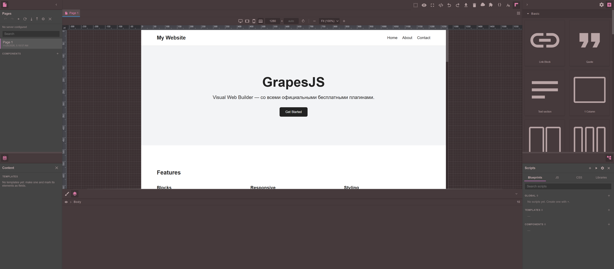

# GrapesJS stand

A single-page playground for [GrapesJS](https://grapesjs.com) 0.21.13 with the official free plugins and our own plugin family, all loaded from npm through CDNs. Open `index.html` and you get a full editor: pages and layouts, visual scripts, fonts, cloud media, rulers, dockable panels, a context menu, React export and a plugin manager that changes plugin options at runtime.



## Run it

The page needs no build step: every script comes from a CDN.

1. Serve this folder with any web server that runs PHP (OSPanel, `php -S localhost:8080`, Apache, nginx + php-fpm). PHP is only needed for the two CORS proxies in `proxy/`; without it everything works except the font catalogues of Fontshare/Fontsource/Bunny and the CDN library search.
2. Open `index.html`.

Opening the file straight from disk (`file://`) is not supported: IndexedDB, the proxies and some plugins expect an `http(s)` origin.

## What is inside

### Our plugins

Sources: `C:\OSPanel6\home\grapesjs-plugins` (one git repository each).

| Package | What it does |
| --- | --- |
| [grapesjs-plugins-manager](https://www.npmjs.com/package/grapesjs-plugins-manager) | Switches plugins on/off, installs plugins from zip archives, edits plugin options (⚙) — live where the plugin supports it, otherwise after a reload; export/import of settings. Loaded first. |
| [grapesjs-sidebar-tools](https://www.npmjs.com/package/grapesjs-sidebar-tools) | Dockable panels (Styles, Settings, Layers, Blocks, other plugins' views), device bar with size and zoom, document workspace with tabs. |
| [grapesjs-site-pages](https://www.npmjs.com/package/grapesjs-site-pages) | Pages, layouts, templates and linked components; per-page undo history, copy/paste between pages, ZIP export/import, local storage or a REST server. |
| [grapesjs-blueprints](https://www.npmjs.com/package/grapesjs-blueprints) | Visual scripts (node graphs compiled to plain JS), JavaScript and CSS of the site (global, per page, per component), CDN libraries. |
| [grapesjs-storage](https://www.npmjs.com/package/grapesjs-storage) | Content entries: templates with typed fields (`data-field`) and the entries that fill them. |
| [grapesjs-fonts](https://www.npmjs.com/package/grapesjs-fonts) | Fonts from Google Fonts, Fontshare, Fontsource and Bunny Fonts for the project (Style Manager, text toolbar). |
| [grapesjs-cloud-assets](https://www.npmjs.com/package/grapesjs-cloud-assets) | Media from Dropbox, Google Drive, OneDrive, Box and S3-compatible storages. |
| [grapesjs-context-menu](https://www.npmjs.com/package/grapesjs-context-menu) | Right-click menu in the canvas and the Layer Manager, clickable hierarchy badge. |
| [grapesjs-export-jsx](https://www.npmjs.com/package/grapesjs-export-jsx) | Exports the page as a React component (JSX + CSS). |
| [grapesjs-ruler](https://www.npmjs.com/package/grapesjs-ruler) | Rulers around the canvas, crosshair, draggable guides, grid around tablet/mobile frames. |

### Official plugins

preset-webpage, blocks-basic, plugin-forms, navbar, tabs, component-countdown, custom-code, tooltip, typed, parser-postcss, style-gradient, style-bg, style-filter, plugin-export, tui-image-editor — versions are pinned in `index.html`.

## How it is wired

Everything lives in `index.html`:

- **Scripts.** Official plugins come from unpkg, ours from jsDelivr, each pinned to a version:

  ```html
  <script src="https://cdn.jsdelivr.net/npm/grapesjs-ruler@0.3.1/dist/grapesjs-ruler.umd.js"></script>
  ```

  Our packages ship their UMD bundle twice: `*.umd.cjs` for Node and `*.umd.js` for browsers. Use the `.umd.js` one in `<script>` tags — CDNs serve `.cjs` as `application/node` and the browser refuses to run it.

- **Plugins by name.** Every bundle registers itself in `grapesjs.plugins` under its npm name, so official and our plugins are listed the same way — as strings:

  ```js
  plugins: ['grapesjs-plugins-manager', 'grapesjs-preset-webpage', /* … */ 'grapesjs-site-pages', 'grapesjs-ruler'],
  pluginsOpts: {
    'grapesjs-site-pages': { /* serverUrl: 'https://example.com/api/v1' */ },
    'grapesjs-fonts': { proxy: '/proxy/fonts-proxy.php' },
  },
  ```

- **Plugin manager.** The whole config goes through `grapesjsPluginsManager.configure({...})`: plugins switched off in the manager are dropped, and options changed in its ⚙ forms are merged into `pluginsOpts` before the plugins start. Those changes live in the browser (localStorage); the manager can export and import them as JSON.

- **Proxies.** `proxy/fonts-proxy.php` (from grapesjs-fonts) and `proxy/libs-proxy.php` (from grapesjs-blueprints) add CORS to catalogue APIs that do not send it. Both keep a small disk cache in the system temp folder.

## Updating our plugins

After publishing new versions from the plugins folder:

```bash
cd C:\OSPanel6\home\grapesjs-plugins
node repos.mjs publish   # publishes every package whose version is newer than npm
node repos.mjs stand     # sets those versions in the stand's jsDelivr links
```

Or change the version in the `<script>` line by hand. jsDelivr may take a few minutes to see a fresh version.

## Files

| Path | Purpose |
| --- | --- |
| `index.html` | The stand: scripts, editor config, initial page content. |
| `proxy/` | CORS proxies for fonts and CDN library search (PHP 7.2+). |
| `_example/` | Screenshot used in this README. |

## Troubleshooting

- **`grapesjsPluginsManager is not defined`** (or another `grapesjs…` global) — the bundle did not load: check the Network tab for a 404 (version not published yet) or a blocked MIME type (a `.umd.cjs` link instead of `.umd.js`).
- **A plugin shows "not in config" in the plugin manager** — it was remembered under an old id; use "Forget".
- **Old code after an update** — the browser cached the script: hard reload (Ctrl+F5).
